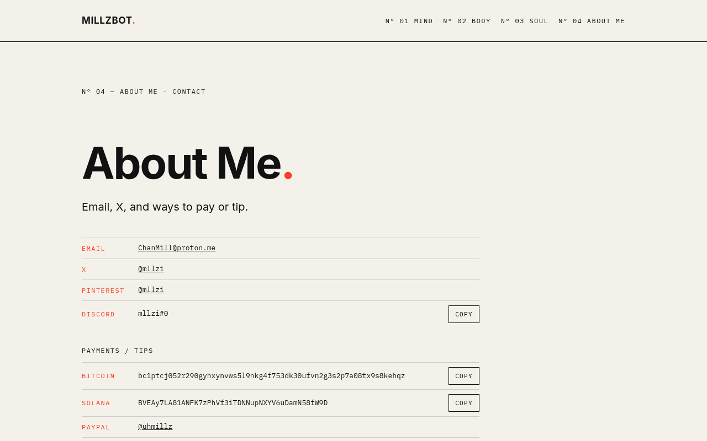

# Millzbot

**Portfolio and study archive of Millz** — psychology, archetypes, philosophy, motivation and creativity, organized into Mind · Body · Soul, alongside the work: sites, Discord communities and bots, brand and video.

**Live:** [millzbot.vercel.app/about](https://millzbot.vercel.app/about/) · **Pages mirror:** [jpxgs.github.io/millzbot](https://jpxgs.github.io/millzbot/)

## Inside
- Single-file, dependency-free site (`index.html`): hand-written HTML, CSS and JS, client-side routing
- Editorial type system: IBM Plex Mono + Inter on warm paper `#F4F1EA`, signal red `#FC3D21`
- SEO: per-route titles and descriptions, Open Graph cards, `sitemap.xml`, `robots.txt`
- `404.html` mirrors `index.html` so deep links work on GitHub Pages

## Run locally
```sh
python3 -m http.server 8000   # then open http://localhost:8000
```

Built by [Millz](https://github.com/jpxgs) · [Ripple Mill Marketing](https://ripplemill.vercel.app)
